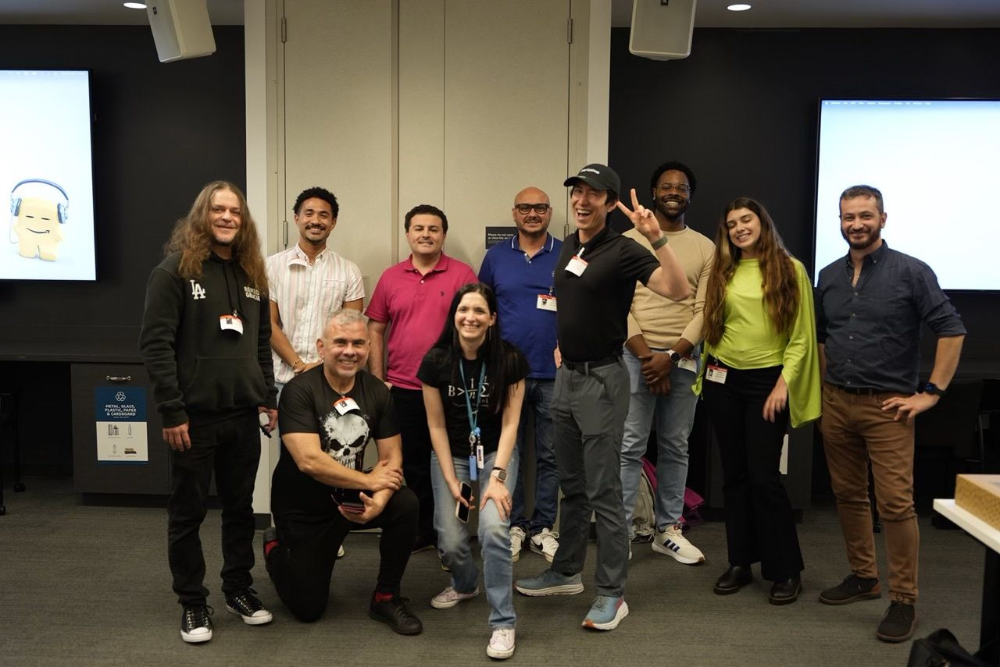
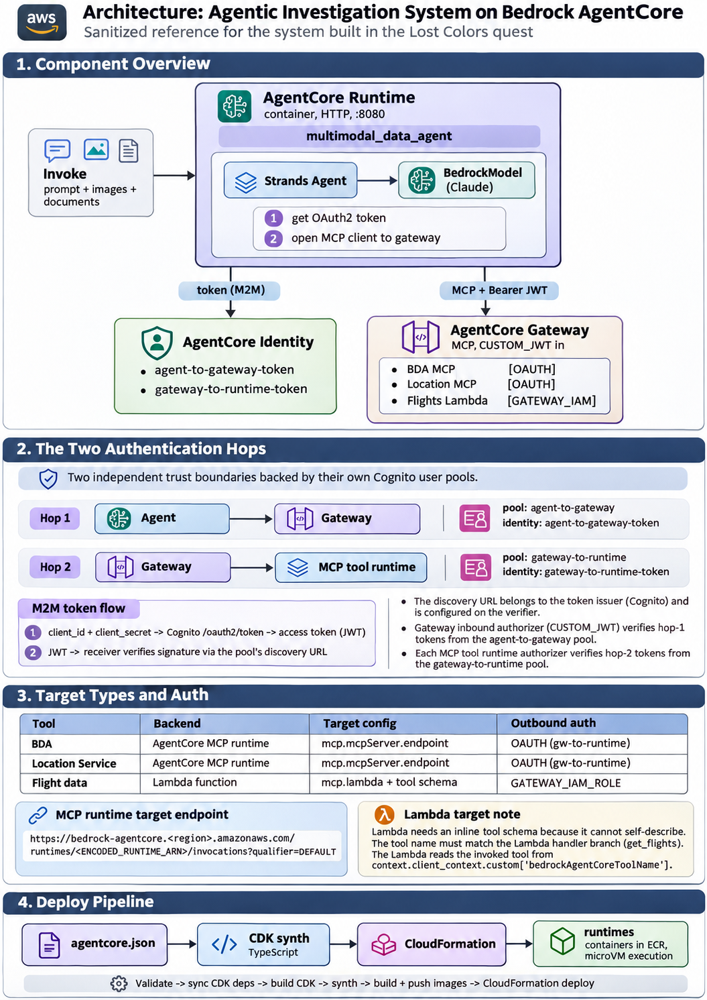
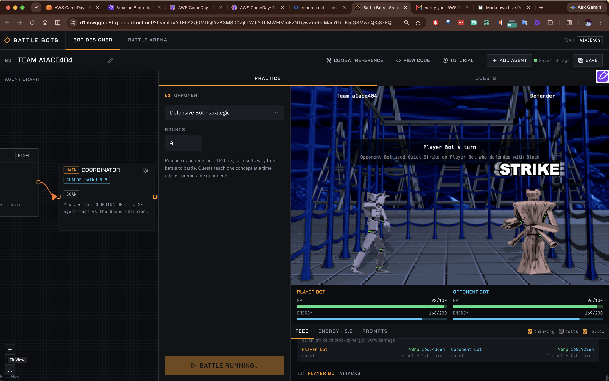

# AWS GameDay | Building Agentic AI Systems

Exploring the infrastructure, architecture, and decision-making principles behind effective AI agents through two hands-on AWS GameDay activities.

## Overview

This GameDay explored two complementary aspects of agentic AI development:

1. **Agent Infrastructure:** How to deploy, secure, and connect an AI agent to external tools and services.
2. **Agent Behavior:** How to design agents that make effective decisions using context, tools, memory, and efficient model selection.

Together, these activities reinforced an important principle:

**An AI agent's capabilities depend not only on the model, but also on the systems, tools, and instructions surrounding it.**

## GameDay Activities

### 1. The Legend of Lost Colors
**Focus: Agent Infrastructure & AWS Architecture**

Built an agentic investigation system using Amazon Bedrock AgentCore, the Strands Agents framework, and Model Context Protocol (MCP).

The agent was designed to analyze evidence, access location information, and query flight data through securely connected tools.

**Key concepts:**
- Amazon Bedrock AgentCore Runtime, Identity, and Gateway
- MCP tool integration and discovery
- OAuth2 authentication and Amazon Cognito
- AWS Lambda, DynamoDB, and Bedrock Data Automation
- Agent deployment, dependency management, and debugging

**[Explore Lost Colors →](./lost-colors/README.md)**

### 2. AI Battle Arena
**Focus: Agent Behavior & Decision-Making**

Completed six progressively challenging AI agent battles, each demonstrating a fundamental principle of effective agent design.

The challenges explored how agent performance changes based on available information, tool configuration, reasoning costs, delegation, and persistent memory.

**Key concepts:**
- Prompt and context engineering
- Tool calling and configuration
- Model selection and token efficiency
- Multi-agent coordination
- Persistent memory and state management
- Balancing architectural constraints

**Result:** Completed all six challenges, earning 30,000 points.

**[Explore AI Battle Arena →](./battle-bots/README.md)**

## Connecting the Lessons

Although the activities approached agent development differently, they reinforced the same underlying engineering principles.

| Dimension | Lost Colors | AI Battle Arena |
|---|---|---|
| Primary focus | Infrastructure | Behavior |
| Tools | MCP integration through AgentCore Gateway | Tool availability and invocation |
| Architecture | Runtime, Identity, Gateway, and services | Single-agent and multi-agent design |
| Security & state | Authentication and authorization | Persistent memory across sessions |
| Reliability | Deployment, dependencies, and debugging | Context, decision rules, and cost efficiency |

### Key Takeaway

Building an effective AI agent requires more than selecting a capable language model.

It requires understanding how to:

- **Provide context** so the agent has the information needed to make decisions.
- **Connect tools** that extend the model's capabilities.
- **Design architecture** that supports secure execution and coordination.
- **Manage costs** through appropriate model selection and reasoning effort.
- **Maintain state** when knowledge must persist across interactions.
- **Validate behavior** through testing, debugging, and observation.

The infrastructure determines what an agent *can access and execute*. Its configuration and decision-making logic determine *how effectively it uses those capabilities*.

## Repository Organization

Each activity has its own directory containing a detailed technical walkthrough, lessons learned, and implementation insights.

These notes serve as both a record of the GameDay experience and a reference for future agentic AI development.
