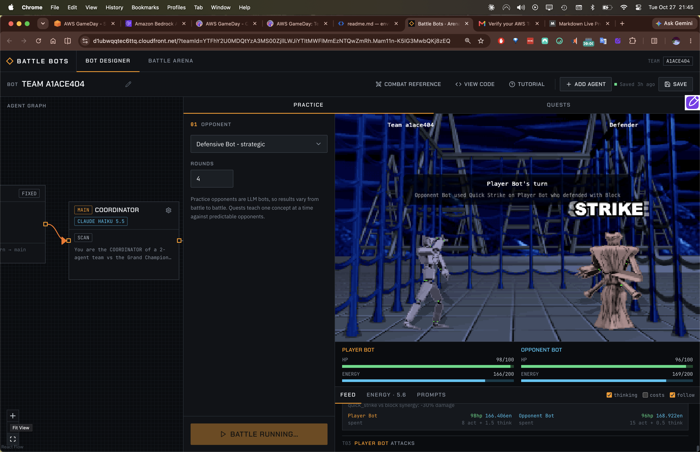
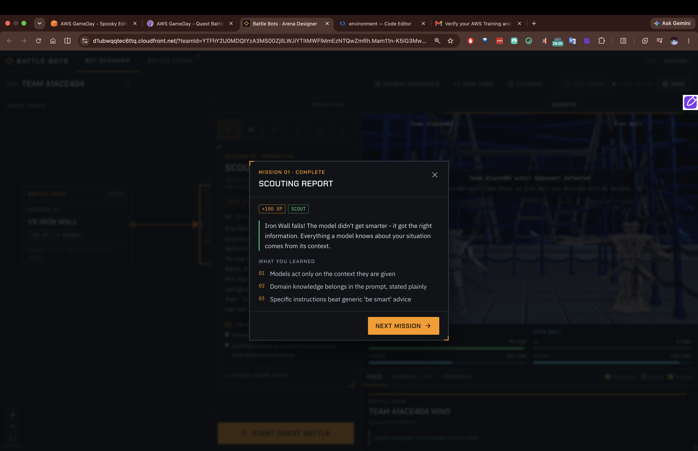
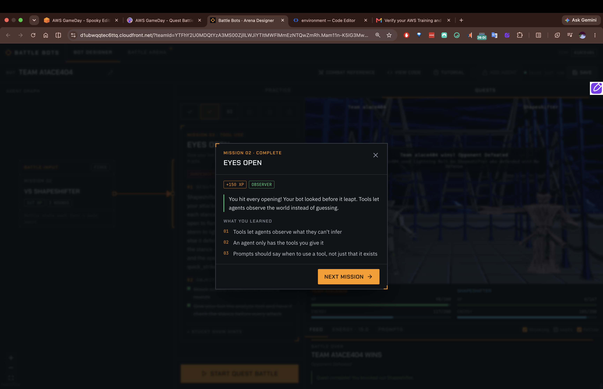
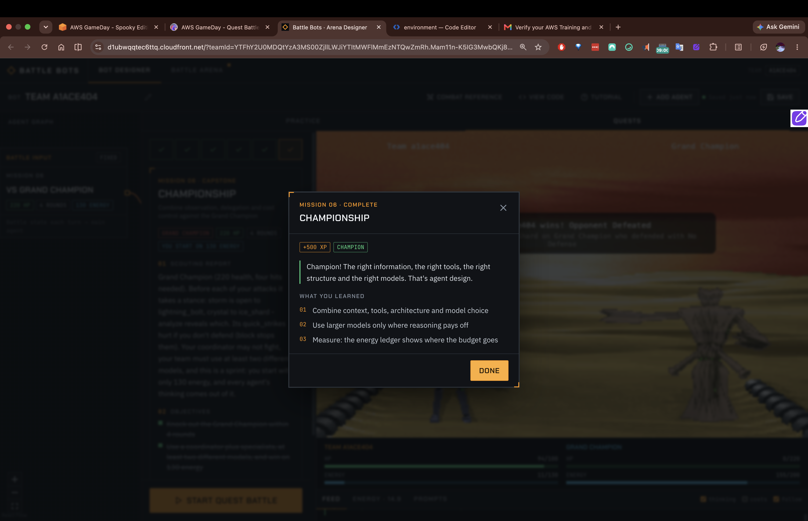

# AI Battle Arena — Six Lessons in Building Effective Agents

## 0. The 30-second version

A capable model is not enough. An agent only acts on the **context** you give it, the **tools** you
attach, within a **cost** budget, structured as one or **many agents**, and across sessions only if
it has **memory**. The six battles each force one of these lessons by designing an opponent you
*cannot* beat without applying it.

```
Context → Tools → Cost → Multi-agent → Memory → (Capstone: all at once)
```




## 1. The core idea the whole arena teaches

> **"A capable model still can't use a fact it was never given."**

Every loss in the arena was a *missing capability or missing fact*, not a "dumb model." The fix was
never "use a smarter model" — it was: give it the right context, the right tool, the right budget,
the right structure, or the right memory. This is the single most transferable lesson for real
agent work.

A mental template that emerged and carried through every level:

```
IDENTITY:    who the bot is (aggressive / adaptive / coordinator…)
ARCHITECTURE: single agent, or coordinator + specialist(s)?
MEMORY:      does knowledge need to survive across turns/battles?
TOOLS:       which tools are attached (must enable in the designer!) + WHEN to use each
FACTS:       the counter matrix, energy costs, synergy multipliers — stated plainly
RULES:       numbered priority order — first match wins
FALLBACK:    always a legal move; conserve resources when stuck
COST:        match model + reasoning effort to task; minimize output tokens
```


## 2. The six lessons

### Level 1 — Scouting Report (**Prompting / Context**)
**Opponent:** Iron Wall — shrugs off the obvious attack.
**Lesson:** Models act only on the context they are given. Domain knowledge belongs in the prompt,
stated plainly. Specific instructions beat generic "be smart" advice.
**What won:** replacing "deal maximum damage" with a **hard priority list**, explicit energy gates,
and the opponent's blind spot written out as a fact (use the attack it's weak to; never feed the
move it defends).
**Transfer:** prompts should encode the actual decision rules and domain facts — not hope the model
infers them.



### Level 2 — Eyes Open (**Tool Use**)
**Opponent:** Shapeshifter — hidden stance that changes every turn; only one attack lands.
**Lesson:** Tools let an agent **observe what it cannot infer**. An agent only has the tools you give
it. The prompt should say **when** to use a tool, not just that it exists.
**The trap I hit:** the prompt told the bot to `analyze` before attacking, but the `analyze` tool was
**never attached** in the designer. The bot literally narrated "I can't call analyze" and lost.
**What won:** attach the tool *and* instruct "call analyze before every attack, then play the matching
move."
**Transfer:** capability lives in configuration, not wishful prompt text. (Same lesson as Lost Colors:
*an agent only has the tools you give it.*)



### Level 3 — Running on Empty (**Cost**)
**Opponent:** Siege Tower — beatable only within a tight energy budget; every *thinking token* costs energy.
**Lesson:** Output tokens — **including the model's reasoning** — are the main cost driver. A smaller
model at low effort is often enough for a well-specified task. Verbose instructions + high effort
multiply cost without improving simple decisions.
**What won:** the move was predetermined (one attack, never defend), so I forbade deliberation, forced
terse output, and lowered reasoning effort — fitting four attacks + thinking inside the budget.
**Transfer:** right-size the model and effort to the task; the cheapest option that works *reliably* is
the correct one.

### Level 4 — Divide and Conquer (**Multi-Agent**)
**Opponent:** Twin Fang — requires a coordinator + specialist split.
**Lesson:** Coordinators **route work**; specialists **hold the tools**. Information must be passed
**explicitly** across the agent boundary. Each agent's prompt should describe its own role.
**What won:** a coordinator with *no* combat tools issuing exact orders, and a specialist holding
`attack`/`defend` that executes them precisely.
**Transfer:** in multi-agent systems, facts don't leak between agents — the coordinator must hand over
every fact the specialist needs. Role boundaries prevent freelancing.

### Level 5 — Remember Me (**Memory**)
**Opponent:** The Gambler — a fixed secret sequence; it reveals *next battle's* answer on your last
turn, but your bot "starts every turn with a blank mind."
**Lesson:** Each session starts with an **empty context**. Memory tools **persist** knowledge across
sessions. Write down what you'll need later; read it back before acting.
**What won:** the explore-then-exploit pattern — deliberately *lose* battle 1 to call `analyze` and
**save** the revealed sequence, then **read** it in battle 2 to hit every opening. Required attaching a
**memory tool** (prompt alone can't persist state).
**Transfer:** statelessness is the default; durable improvement across runs requires an explicit
memory mechanism and the discipline to write/read it.

### Level 6 — Championship (**Capstone**)
**Opponent:** Grand Champion — fuses observe + delegate + cost into one fight, on a tight budget,
requiring ≥2 different models.
**Lesson:** real agent design is **all the levers at once**. The "two different models" rule became a
*strategy*: put the cheapest/low-effort model on the deterministic specialist, a different cheap model
on the coordinator — satisfying the rule *and* surviving the energy budget.
**What won:** coordinator sets a fixed doctrine (analyze → play matching move; block the early
quick_strike), specialist executes with minimal thinking; round-trips minimized to protect the budget.
**Transfer:** production agents juggle context, tools, cost, structure, and memory simultaneously —
and the right model choice is per-role, not one-size-fits-all.



## 3. The through-line to real agent engineering

| Arena lesson | Real-world equivalent |
|||
| Context | Prompt/context engineering; put domain knowledge in the prompt |
| Tools | Tool/function calling; capability = what you attach, used *when* instructed |
| Cost | Token economics; right-size model + reasoning effort |
| Multi-agent | Orchestrator/worker patterns; explicit inter-agent handoffs |
| Memory | State persistence; vector/KV memory; explore-then-exploit |
| Capstone | Systems design: all constraints balanced at once |

Both quests taught the **same meta-lesson from two angles**:
- **Battle Bots:** behavior — *the model only acts on what you give it.*
- **Lost Colors:** infrastructure — *the agent can only use the tools/identity/endpoints you wire up.*

Capability is something you **provide**, deliberately — in the prompt, in the tool config, in the
architecture, in the memory, in the model choice. That's the job.


## 4. Habits to keep

- Write **facts and decision rules** into the prompt; don't rely on the model to infer domain truth.
- Make tool use **conditional and explicit** ("call X before Y"), and verify the tool is actually attached.
- Treat **reasoning tokens as cost**; use the smallest model/effort that is *reliably* sufficient.
- For multi-agent: give each agent a **role** and pass information **explicitly** across boundaries.
- For anything that must improve over time: attach **memory** and read it **before** acting.
- When a bot "fails," ask **"what fact or capability is it missing?"** before blaming the model.
