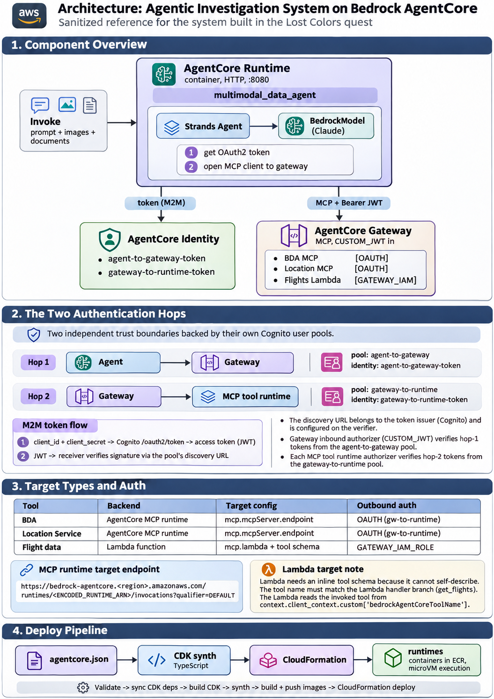

# Building an Agentic Investigation System on Amazon Bedrock AgentCore

## 0. The 30-second version

I built an AI agent that can analyze images/documents and answer investigation questions by
calling three real tools (media analysis, location services, flight data). To do that, an LLM
alone is not enough — it needs **somewhere to run**, a way to **prove its identity**, **one
unified door to its tools**, and the **tools themselves**. Amazon Bedrock AgentCore provides
those as four building blocks: **Runtime, Identity, Gateway, and tool targets**, with the
**Strands** framework + a **Bedrock** model doing the reasoning.

```
Runtime (where it runs) + Identity (who it is) + Gateway (one door to tools) + Tools (what it can do)
```


## 1. The goal, and why a plain LLM can't meet it

**Goal:** an agent that takes a prompt plus images/documents, reasons about a case, and pulls
real data (flights, locations, document insights) to answer questions.

A raw LLM has two hard limits for this:
1. **It only knows its training data.** It can't look up *today's* flights or a specific
   place — it needs **tools** (live data sources / functions).
2. **It's just a model, not a service.** It has no address to call, no identity, no way to
   securely reach external systems. It needs **infrastructure** around it.

Everything below exists to close those two gaps. The useful mental habit: for each component,
ask *"what would break if this didn't exist?"*





## 2. Each component as the answer to a specific need

### 2.1 AgentCore Runtime — "the agent needs somewhere to run"
**Need:** The agent is code (a Python app). Something must host it, keep it running, expose it
to callers, scale it, and isolate it securely.

**Why this service:** AgentCore **Runtime** runs your agent as a **container** inside a managed,
serverless, isolated environment (Firecracker microVMs). You hand it a container image; it owns
the lifecycle — starting instances per request, scaling, streaming responses, logging to
CloudWatch. You don't manage servers.

**AWS ecosystem context:** this is the same serverless-container idea as **Lambda/Fargate**, but
purpose-built for agents (long-running, streaming, tool-using). The container is built with
**Docker**, pushed to **ECR**, and deployed via **CloudFormation** (generated from CDK).

**Without it:** you'd be manually provisioning EC2/containers, load balancers, scaling, and
isolation yourself.

### 2.2 Strands + Bedrock — "the agent needs a brain and a way to think with tools"
**Need:** Something must run the *agentic loop*: send the prompt to an LLM, let it decide to
answer or call a tool, run the tool, feed the result back, repeat.

**Why these:** **Amazon Bedrock** provides the model (Claude Sonnet) via a managed API — no model
hosting. **Strands** is the agent framework that drives the loop and adapts the model to tools.
Separation of concerns: Bedrock = the brain, Strands = the decision/execution loop.

**Without it:** you'd hand-code the model API calls, the tool-dispatch logic, and the
conversation state machine.

### 2.3 AgentCore Identity — "the agent needs to prove who it is"
**Need:** The agent will call tools that must **not** be open to the world. It needs verifiable
credentials to authenticate — and ideally short-lived tokens, not static secrets.

**Why this service:** AgentCore **Identity** holds **OAuth2 credential providers**. Each provider
wraps a machine identity (here, an **Amazon Cognito** app client) under a **name**. The agent code
just says `@requires_access_token(provider_name="agent-to-gateway-token")` and AgentCore fetches a
fresh token for it automatically (machine-to-machine / client-credentials flow).

**AWS ecosystem context:** **Cognito** is the identity provider (the user/app-client directory and
token issuer). AgentCore Identity is the layer that lets the *agent* consume those identities
cleanly. Two distinct things: Cognito = raw IdP; AgentCore Identity provider = the named wrapper.

**Without it:** you'd manually store client secrets in the agent, call Cognito's token endpoint by
hand, cache/refresh tokens, and risk leaking long-lived credentials.

### 2.4 AgentCore Gateway — "the agent needs ONE door to MANY tools"
**Need:** There are several tools, each in a different place, with different protocols and
different auth. Making the agent talk to each one directly would hard-code locations, credentials,
and API shapes into the agent — brittle and insecure.

**Why this service (the sharpened purpose):** the Gateway is **unification + mediation**, not
orchestration. It gives the agent a **single endpoint and a single protocol (MCP)** to reach all
tools. It **verifies who may call it** (inbound auth) and **handles how it calls each tool**
(outbound auth + protocol translation). The agent discovers tools dynamically through this one
door; add or remove a tool at the gateway and the agent picks it up with **no code change**.

> Note on wording: the *Strands agent loop* decides *which* tool to call (that's orchestration).
> The *gateway* provides and secures the *connection* to tools. One door to many tools, with
> security handled at the door.

**Without it:** every tool's URL, credential, and API contract would be embedded in the agent; every
new tool would mean an agent code change and redeploy.

### 2.5 The tools (gateway targets) — "the agent needs actual capabilities"
Three tools, attached to the gateway as **targets**:

- **Bedrock Data Automation (BDA)** MCP server — analyze documents/images/audio/video. *Why:* the
  case involves media evidence.
- **Amazon Location Service** MCP server — geocoding, place search, routing. *Why:* tracking
  locations and movement.
- **Flight data Lambda** (`FlightQueryFunction`) — query a DynamoDB flights table by airport+time.
  *Why:* narrowing down suspect movements by air travel.

**AWS ecosystem context:** the first two are MCP servers we hosted on AgentCore Runtime (same hosting
story as the agent). The third is a plain **Lambda** fronting **DynamoDB** — showing the gateway can
expose *existing* AWS resources as agent tools, not just MCP servers.


## 3. The sequential story — why the order is forced

The build order isn't arbitrary; each step depends on outputs of the previous one. This is the part
worth re-reading to rebuild intuition.

```
1. IAM role            ─ nothing can run without an execution identity/permissions.
          │
2. Cognito pools       ─ the raw identities for the two auth boundaries must exist…
          │
3. AgentCore Identity  ─ …before we can wrap them as named OAuth2 credential providers
   (OAuth2 providers)     the agent/gateway will reference.
          │
4. Agent Runtime       ─ the agent can be deployed and reach READY even before tools exist,
                          because tool calls only happen at invoke time, not at startup.
          │
5. Gateway             ─ needs an inbound identity (from step 3) to authorize callers.
          │               You can't point the agent at a gateway that doesn't exist yet —
          │               which is why the agent's gateway-URL is filled AFTER this step.
          │
6. Tool runtimes/Lambda─ deploy the tool backends.
          │
7. Gateway targets     ─ attach each tool to the gateway, each with its outbound credential.
                          Only now can the agent actually DO anything useful.
```

**The dependency logic in one line:** *identities before the things that trust them; the gateway
before the agent can point at it; the tools before they can be attached; everything attached before
the agent is actually useful.*

**Two auth hops** fall straight out of this (the security spine):
- **Hop 1 — Agent → Gateway:** the agent proves it may use the gateway (inbound auth, CUSTOM_JWT,
  `agent-to-gateway` identity).
- **Hop 2 — Gateway → Tool:** the gateway proves it may call each tool (outbound auth;
  **OAUTH** for the MCP servers via `gateway-to-runtime` identity, **GATEWAY_IAM_ROLE** for the
  Lambda). Two independent trust boundaries, each with its own Cognito pool.


## 4. How the pieces talk at request time (the runtime story)

```
caller → invoke(prompt + images + documents)
      → Runtime starts the agent container
      → agent gets an OAuth2 token from AgentCore Identity          (hop 1 credential)
      → agent opens an MCP session to the Gateway with that token   (hop 1 auth)
      → gateway exposes all tools; agent discovers them
      → Strands + Claude reason; when a tool is needed, the call goes
        through the gateway, which authenticates to the tool         (hop 2 auth)
      → results flow back; the model composes an answer
      → response streams back to the caller
```

The key insight: **the agent only ever knows one endpoint (the gateway) and one identity.** All the
heterogeneity of the tools (different hosts, protocols, credentials) is absorbed by the gateway.


## 5. The bugs (one theme, four faces)

**Theme: unpinned dependencies + an upstream major-version break (`mcp` 1.x → 2.x).** A runtime
reaching `READY` only means the container *deployed* — not that the app *runs*. The real failures
surfaced only when code actually executed.

| # | Where | Error | Cause | Fix |
||-|-|-|--|
| 1 | Agent (MCP client import) | `cannot import name 'streamablehttp_client'` | 2.x renamed the symbol | import new name / pin <2 |
| 2 | BDA server | `No module named 'mcp.server.fastmcp'` | 2.x removed `FastMCP` (→`MCPServer`) | pin `mcp[cli]>=1.11.0,<2` |
| 3 | Location server | same as #2 | same | same pin |
| 4 | Agent (MCP client call) | `streamable_http_client() unexpected kwarg 'headers'` | 2.x changed the signature | pin agent's `mcp<2` |

**Also:**
- **MCP client lifecycle:** the agent must run **inside** the MCP client context manager
  (`with mcp_client:`), or the session closes before tools are used
  (`"client session is not running"`).
- **CDK `node_modules` corruption** after an auto dependency bump blocked `agentcore deploy` synth;
  fixed with a clean reinstall in `agentcore/cdk`.
- **Gateway target FAILED** for BDA on first attempt — because the *backend runtime* was still
  crashing (bug #2). A failing target often points one layer down, at a broken backend.


## 6. Lessons to carry forward

- **Pin dependencies with upper bounds** for fast-moving libraries. `>=x` alone is a time bomb.
- **"Deployed" ≠ "healthy."** Always invoke/exercise the thing; read CloudWatch logs.
- **Read provided code before running it.** The Lambda contract and the mcp bugs were all findable
  by reading source first.
- **Trace file-to-file transitions.** `agentcore.json` → Dockerfile → requirements → image →
  container → app. Ask "what does this point to next, and by what mechanism?"
- **Map auth boundaries explicitly** before wiring. Draw who-authenticates-to-whom with which credential.
- **Diagnose root cause, not symptoms** — the target failure was a runtime crash underneath.
- **Match the service to the need.** Runtime=hosting, Identity=who-am-I, Gateway=one-secure-door,
  Bedrock=brain, Strands=the loop. If you can state the *need* each service answers, you understand
  the architecture.


## 7. AWS services used, at a glance

| Service | Role here | The general thing it does |
||||
| Bedrock AgentCore Runtime | hosts the agent + MCP tool servers | serverless, isolated agent/container hosting |
| Bedrock (model) | the reasoning model (Claude) | managed foundation-model inference |
| Bedrock AgentCore Identity | OAuth2 credential providers | lets agents obtain/verify tokens |
| Amazon Cognito | user pools + M2M app clients | identity provider / token issuer |
| Bedrock AgentCore Gateway | one MCP door to all tools | unify + secure + translate tool access |
| Bedrock Data Automation | media/document analysis tool | GenAI multimodal extraction |
| Amazon Location Service | geocoding/routing tool | maps & location data |
| AWS Lambda + DynamoDB | flight-data tool | serverless function + NoSQL store |
| IAM | execution roles & permissions | who-can-do-what |
| ECR / CloudFormation / CDK | build & deploy pipeline | image registry + infra-as-code |


## 8. Final deliverables (verified `READY`)

- Agent runtime: `multimodal_data_agent` (lists all 11 tools across 3 targets end-to-end)
- Identities: `agent-to-gateway-token`, `gateway-to-runtime-token`
- Gateway: `lost-colors-gateway-...` (CUSTOM_JWT inbound)
- Targets: BDA MCP, Location MCP (OAUTH) + Flights Lambda (GATEWAY_IAM_ROLE)

See `architecture.md` for diagrams, auth flows, and sanitized code snippets.
