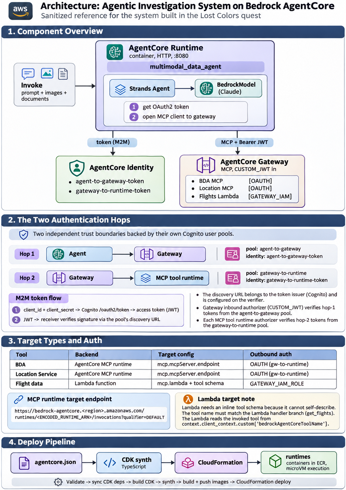

# Architecture: Agentic Investigation System on Bedrock AgentCore

A sanitized reference for the system built in the "Lost Colors" quest. All account IDs,
pool IDs, and secrets are replaced with placeholders.


## Component overview

```
                         ┌─────────────────────────────────────────────┐
                         │  AgentCore Runtime (container, HTTP, :8080)   │
   invoke  ───────────▶  │  multimodal_data_agent                        │
 (prompt + images +      │                                               │
  documents)             │  Strands Agent ── BedrockModel (Claude)       │
                         │        │                                      │
                         │        ├─ 1. get OAuth2 token                 │
                         │        └─ 2. open MCP client to gateway       │
                         └────────┬───────────────────────┬─────────────┘
                                  │ token (M2M)            │ MCP + Bearer JWT
                                  ▼                        ▼
                        AgentCore Identity        AgentCore Gateway (MCP, CUSTOM_JWT in)
                        ┌────────────────┐        ┌──────────────────────────────────┐
                        │ agent-to-       │        │ targets:                         │
                        │  gateway-token  │        │   BDA MCP        [OAUTH]          │
                        │ gateway-to-     │        │   Location MCP   [OAUTH]          │
                        │  runtime-token  │        │   Flights Lambda [GATEWAY_IAM]    │
                        └────────────────┘        └──────────────────────────────────┘
```





## The two authentication hops

Two independent trust boundaries, each backed by its own Cognito user pool.

```
Hop 1  Agent  ──▶  Gateway        pool: agent-to-gateway      identity: agent-to-gateway-token
Hop 2  Gateway ─▶  MCP tool runtime  pool: gateway-to-runtime  identity: gateway-to-runtime-token
```

**M2M (client-credentials) token flow (per hop):**
```
client_id + client_secret ──▶ Cognito /oauth2/token ──▶ access token (JWT)
JWT ──▶ (receiver verifies signature via the pool's discovery URL)
```
- The **discovery URL** belongs to the token *issuer* (Cognito) and is configured on the *verifier*.
- The gateway's **inbound** authorizer (CUSTOM_JWT) verifies hop-1 tokens from the agent-to-gateway pool.
- Each MCP tool runtime's authorizer verifies hop-2 tokens from the gateway-to-runtime pool.


## Target types and their auth

| Tool              | Backend                    | Target config              | Outbound auth        |
|-|-|-|-|
| BDA               | AgentCore MCP runtime      | `mcp.mcpServer.endpoint`   | OAUTH (gw-to-runtime)|
| Location Service  | AgentCore MCP runtime      | `mcp.mcpServer.endpoint`   | OAUTH (gw-to-runtime)|
| Flight data       | Lambda function            | `mcp.lambda` + tool schema | GATEWAY_IAM_ROLE     |

- **MCP runtime target** endpoint format (URL-encode the runtime ARN):
  ```
  https://bedrock-agentcore.<region>.amazonaws.com/runtimes/<ENCODED_RUNTIME_ARN>/invocations?qualifier=DEFAULT
  ```
- **Lambda target** needs an inline tool schema because a Lambda can't self-describe.
  The tool `name` must match the branch in the Lambda handler (`get_flights`), and the Lambda
  reads the invoked tool from `context.client_context.custom['bedrockAgentCoreToolName']`.


## Illustrative: creating the OAuth2 credential provider (sanitized)

```python
client.create_oauth2_credential_provider(
    name="agent-to-gateway-token",
    credentialProviderVendor="CustomOauth2",
    oauth2ProviderConfigInput={
        "customOauth2ProviderConfig": {
            "oauthDiscovery": {
                "discoveryUrl": "https://cognito-idp.<region>.amazonaws.com/<POOL_ID>/.well-known/openid-configuration"
            },
            "clientId": "<CLIENT_ID>",
            "clientSecret": "<CLIENT_SECRET>",  # never commit a real secret
        }
    },
)
```

## Illustrative: Lambda gateway target tool schema (sanitized)

```python
targetConfiguration={
    "mcp": {
        "lambda": {
            "lambdaArn": "<LAMBDA_ARN>",
            "toolSchema": {
                "inlinePayload": [{
                    "name": "get_flights",           # must match the Lambda's branch
                    "description": "Query flights by departure airport and time.",
                    "inputSchema": {
                        "type": "object",
                        "properties": {
                            "departureAirport": {"type": "string"},
                            "scheduledDeparture": {"type": "string"}
                        },
                        "required": ["departureAirport", "scheduledDeparture"]
                    }
                }]
            }
        }
    }
},
credentialProviderConfigurations=[{"credentialProviderType": "GATEWAY_IAM_ROLE"}]
```


## Deploy pipeline (what `agentcore deploy` does)

```
agentcore.json ──▶ CDK synth ──▶ CloudFormation ──▶ runtimes
                    (TypeScript)                     (containers in ECR, microVM execution)
```
Validate -> sync CDK deps -> build CDK -> synth -> build+push images -> CloudFormation deploy.
